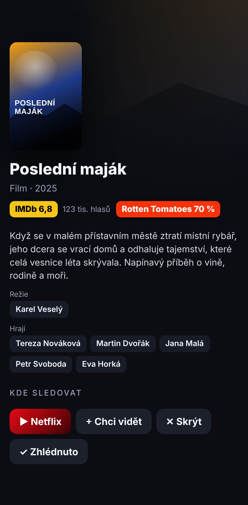
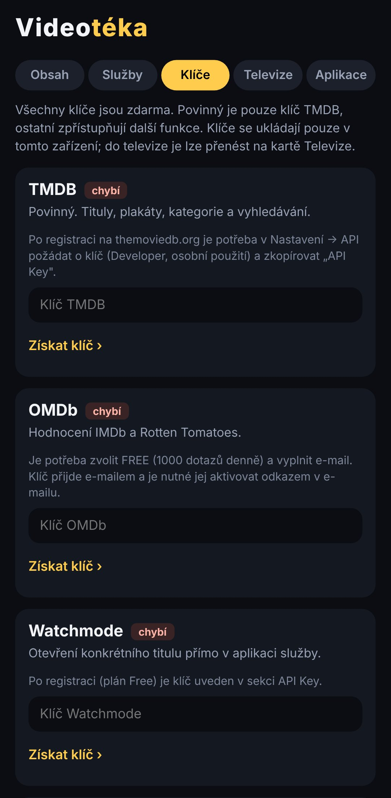

# Videotéka

**Přehled všech streamovacích služeb na jedné obrazovce.** Videotéka spojuje nabídku služeb
Netflix, HBO Max, Disney+, Prime Video, Apple TV a SkyShowtime, třídí ji podle žánrů a ke každému
titulu zobrazuje hodnocení IMDb a Rotten Tomatoes. U každého titulu je uvedeno, ve které
z vybraných služeb je k dispozici, a jedním výběrem se otevře v aplikaci dané služby.

Aplikace je určena pro **telefony s Androidem** a **televize Samsung**. Je zdarma, bez reklam
a nevyžaduje registraci.

<p align="center">
  
</p>
<p align="center">
  
  
  
</p>

<sub>Snímky obrazovky pocházejí z ukázkových dat, názvy titulů jsou smyšlené.</sub>

## Hlavní funkce

- **Jednotný katalog.** Kategorie jako Krimi, Sci-fi, Komedie nebo Dokumenty obsahují pouze tituly
  dostupné ve vybraných službách.
- **Hodnocení IMDb a Rotten Tomatoes** přímo na plakátech, včetně filtru podle hodnocení
  (například pouze IMDb 7 a více).
- **Česká tvorba a český dabing.** Jedním tlačítkem lze zobrazit pouze české tituly nebo pouze
  tituly s českým zvukem.
- **Přímé přehrání.** V telefonu se titul otevře přímo v aplikaci příslušné služby.
- **Novinky a kalendář.** Přehled nově přidaných titulů, titulů, které brzy ze služby odejdou,
  a termínů nových dílů sledovaných seriálů.
- **Seznamy Chci vidět a Zhlédnuto.** Vlastní seznam napříč službami; nezajímavé tituly lze skrýt.
- **Telefon jako ovladač.** Po spárování telefonu s televizí pomocí QR kódu lze tituly posílat
  z telefonu do televize.
- **Automatické aktualizace.**

## Instalace do telefonu (Android)

1. **[Stáhnout Videoteka.apk](https://github.com/zarybjir/Tv_app/releases/latest/download/Videoteka.apk)**
2. Stažený soubor je potřeba otevřít a povolit instalaci z tohoto zdroje.
3. Ve Videotéce v **Nastavení → Klíče** vložit klíče (viz níže). U každého klíče je
   odkaz **Získat klíč** a stručný postup.

## Klíče

Videotéka čerpá data z veřejných filmových databází. Každá z nich vyžaduje vlastní bezplatný
klíč, který si každý uživatel zřizuje sám. Povinný je pouze klíč TMDB, ostatní zpřístupňují
další funkce.

| Klíč | Účel | Kde jej získat |
|---|---|---|
| **TMDB** (povinný) | tituly, plakáty, kategorie, vyhledávání | [themoviedb.org → Nastavení → API](https://www.themoviedb.org/settings/api): po [registraci](https://www.themoviedb.org/signup) požádat o klíč (Developer, osobní použití) a zkopírovat *API Key* |
| **OMDb** | hodnocení IMDb a Rotten Tomatoes | [omdbapi.com/apikey.aspx](https://www.omdbapi.com/apikey.aspx): zvolit FREE; klíč přijde e-mailem a je nutné jej aktivovat odkazem v e-mailu |
| **Watchmode** | otevření konkrétního titulu v aplikaci služby | [api.watchmode.com](https://api.watchmode.com/requestApiKey/): registrace (Free), klíč je uveden v sekci API Key |
| **Movie of the Night** | český dabing, nově přidané a odcházející tituly | [developers.movieofthenight.com](https://developers.movieofthenight.com/): registrace, plán Free, zkopírovat API key |

Klíče se ukládají pouze v telefonu, případně v televizi, a nikam dalšímu se neodesílají.

### Limity bezplatných klíčů

- **OMDb:** 1 000 dotazů denně. Hodnocení se ukládají na 7 dní; první spuštění spotřebuje
  přibližně 120 dotazů, další pouze několik na nové tituly. Po vyčerpání limitu filtr dočasně
  nic neskrývá a aplikace na to upozorní. Seriály na Rotten Tomatoes často hodnocení nemají.
- **Watchmode:** 1 000 dotazů měsíčně. Dotaz se odesílá pouze po stisku „▶" a odkaz se ukládá
  na 30 dní.
- **Movie of the Night:** 1 000 dotazů měsíčně. Řádky s dabingem se ukládají na 3 dny, údaje
  o titulu na 30 dní. Spotřeba je uvedena v *Nastavení → Aplikace*. Při 950 dotazech za měsíc
  se dotazy zastaví a obnoví se 1. dne dalšího měsíce.

## Instalace do televize Samsung

Do televize se Videotéka instaluje prostřednictvím vývojářského režimu. Nastavení je
jednorázové.

**Na počítači (Windows, macOS i Linux):**

1. Nainstalovat [Tizen Studio](https://developer.tizen.org/development/tizen-studio/download).
2. V *Package Manageru* (*Tools → Package Manager → Extension SDK*) doinstalovat
   **TV Extensions** a **Samsung Certificate Extension**.

**Na televizi:**

3. Otevřít *Aplikace (Apps)* a na ovladači zadat **1 2 3 4 5**.
4. Zapnout **Developer mode**, jako *Host PC IP* zadat IP adresu počítače a televizi
   restartovat (vypnout a zapnout).

**Na počítači:**

5. V Tizen Studiu otevřít *Tools → Device Manager → Remote Device Manager → +*, zadat IP
   adresu televize a připojit se.
6. V *Tools → Certificate Manager → +* zvolit **Samsung**, typ **TV**, přihlásit se účtem
   Samsung a vytvořit autorský i distributorský certifikát. Distributorský certifikát se váže
   k připojené televizi (DUID se doplní automaticky).
7. V Device Manageru kliknout na televizi pravým tlačítkem a zvolit
   **Permit to install applications**. Bez tohoto kroku televize instalaci odmítá
   s chybou `install failed[118]`.
8. Založit projekt: *File → New → Tizen Project → Template → TV → Web Application →
   Basic Project* s názvem `Videoteka`. Ve složce projektu smazat vygenerované soubory kromě
   `.project`, `.tproject` a `.settings` a nakopírovat obsah tohoto repozitáře
   (`config.xml`, `index.html`, `icon.png`, `version.json`, složky `css` a `js`;
   soubory `js/jsqr.js` a `js/jsqr.LICENSE.txt` televize nepotřebuje).
9. Kliknout na projekt pravým tlačítkem a zvolit *Run As → Tizen Web Application*.

Videotéka se objeví mezi aplikacemi v televizi. Doporučuje se ji připnout na domovskou lištu.
Certifikát z vývojářského režimu platí přibližně rok, poté je potřeba aplikaci nahrát znovu
stejným postupem a se stejným certifikátem.

### Instalace z příkazové řádky

```sh
tizen package -t wgt -s <jméno-profilu-certifikátu> -- .
sdb connect <IP-televize>
tizen install -n <vzniklý-soubor>.wgt -t <jméno-zařízení-ze-sdb-devices>
```

Pokud `tizen install` na starší televizi (2016–2017) selže, lze balíček nainstalovat přímo
(z adresáře `C:\tizen-studio\tools`, každý příkaz zvlášť):

```
sdb.exe -s <IP-televize>:26101 install "C:\…\Videoteka.wgt"
sdb.exe -s <IP-televize>:26101 shell 0 vd_appinstall PrMtArNa01.Videoteka /home/owner/share/tmp/sdk_tools/Videoteka.wgt
```

Hlášení „closed" po prvním příkazu je v pořádku, instalaci provede až druhý příkaz.
Na starších televizích je ověřeno Tizen Studio 6.1.

### Klíče do televize

Klíče není nutné do televize přepisovat, přenesou se z mobilní Videotéky:

1. V televizi otevřít *Nastavení → Telefon → Zapnout*. Zobrazí se QR kód.
2. V telefonu otevřít *Nastavení → Televize → Naskenovat QR kód*. Pokud nelze použít
   fotoaparát, je možné opsat 20znakový kód pod QR kódem.
3. Telefon odešle klíče, televize je uloží a sama se restartuje.

Spárování zároveň zpřístupní tlačítko *Poslat do TV* v telefonu. Zprávy procházejí veřejnou
službou ntfy.sh a jsou zašifrované kódem z QR kódu, který se nikam neodesílá.

### Když se některá služba nespustí

Videotéka vyhledává aplikace v televizi podle názvu. Pokud některou nenajde (na dlaždici je
uvedeno „nenalezeno v TV"), lze ji v *Nastavení → Služby → Aplikace* vybrat ze seznamu
nainstalovaných aplikací. Tlačítko **Vyzkoušet** ověří, že se spustí.

### Ovládání

| Tlačítko | Akce |
|---|---|
| Šipky | pohyb |
| OK | otevřít nebo spustit |
| Zpět | o krok zpět; na domovské obrazovce zavře aplikaci |
| Červené / zelené / žluté | skrýt titul / označit jako zhlédnutý / vrátit poslední skrytí |

Funguje i ukazovátko (Smart Remote nebo myš).

---

## Všechny funkce podrobně

- **Služby:** dlaždice, které jedním stiskem OK spustí aplikaci služby.
- **Kategorie:** domovská obrazovka je rozdělená do řádků podle žánrů (Krimi, Thrillery
  a záhady, Fantasy, Sci-fi, Akční, Komedie, Drama, Animované, Dokumenty…). Každý řádek
  obsahuje pouze tituly dostupné ve vybraných službách; štítek na plakátu uvádí službu.
- **Celá kategorie:** na konci každého řádku je dlaždice **Zobrazit vše ›**, v telefonu
  lze klepnout i na název řádku. Otevře se mřížka plakátů a další tituly se při posouvání
  načítají automaticky.
- **Dokumenty po podkategoriích:** příroda a zvířata, skutečné zločiny, historie, válka,
  věda a vesmír, sport a hudba. Zapínají se v *Nastavení → Obsah → Dokumenty*; v rozbalené
  kategorii Dokumenty se mezi nimi přepíná záložkami.
- **Obsah domovské obrazovky:** v *Nastavení → Obsah* lze zapnout nebo vypnout seriály
  a filmy, jednotlivé kategorie (16 žánrů), řádek **Nejpopulárnější** a řádky podle služeb.
  Tamtéž lze změnit pořadí řádků.
- **Skrývání titulů:** nezajímavé nebo zhlédnuté tituly lze jedním tlačítkem skrýt ze všech
  řádků (na plakátu červené tlačítko = skrýt, zelené = zhlédnuto, žluté = vrátit poslední
  skrytí; totéž je v detailu titulu). Skryté tituly lze vrátit v *Nastavení → Aplikace →
  Skryté a zhlédnuté tituly*.
- **Série a díly:** u seriálu se v části *Série a díly* zobrazí série a u každého dílu název,
  datum, délka, popis a obrázek. Výběrem dílu se seriál otevře ve službě a Videotéka si
  uloží rozkoukaný díl: zhlédnuté díly mají ✓ a následující díl je zvýrazněný.
- **Nově přidáno:** nové filmy (poslední 4 měsíce) a seriály s novým dílem za poslední
  měsíc, pokud jsou dostupné ve vybraných službách. S klíčem Movie of the Night řádek
  zobrazuje skutečně nově přidané tituly do katalogu služeb.
- **Brzy odchází** (s klíčem Movie of the Night): tituly, které ze služeb odcházejí, s datem.
  Tituly ze seznamu *Chci vidět*, které odcházejí, mají štítek s datem a upozornění nahoře
  na domovské obrazovce.
- **Nové díly a řady:** u seriálů ze seznamu *Chci vidět* a u zhlédnutých seriálů se zobrazí
  štítek *Nová řada 3*, *Nové díly* nebo *Další díl 1. 12.* Po zhlédnutí nových dílů je
  potřeba seriál znovu označit zeleným tlačítkem.
- **Nově ve vybraných službách:** když se titul ze seznamu *Chci vidět* objeví v některé
  z vybraných služeb, zobrazí se nahoře na domovské obrazovce. Kontrola probíhá při spuštění,
  nejvýše dvakrát denně.
- **Hodnocení IMDb a Rotten Tomatoes** u každého plakátu, v detailu navíc počet hlasů
  a Metacritic.
- **Filtr podle hodnocení:** tlačítka *IMDb* (6+ / 6,5+ / 7+ / 7,5+ / 8+) a *RT*
  (60 / 75 / 90 %+) nahoře na domovské obrazovce. Filtr platí pro řádky a vyhledávání,
  nikoli pro vlastní seznam. Tituly bez hodnocení filtr skryje.
- **Česká tvorba:** tlačítko *Jazyk* přepne řádky, rozbalené kategorie i vyhledávání pouze
  na české filmy a seriály.
- **Český dabing:** další stisk tlačítka *Jazyk* zobrazí pouze tituly s českým zvukem
  v některé z vybraných služeb. Štítek **CZ** na plakátu označuje ověřený dabing; detail
  titulu uvádí dabing a titulky u každé služby zvlášť. Vyžaduje klíč Movie of the Night.
- **Herci a tvůrci:** detail titulu uvádí režii (u seriálů tvůrce) a hlavní herce. Výběrem
  jména se otevře přehled titulů s danou osobou ve vybraných službách.
- **Kalendář:** po dnech zobrazuje nové tituly ve vybraných službách a další díly
  sledovaných seriálů.
- **Poslat do TV:** po spárování otevře tlačítko *Poslat do TV* v detailu titulu v telefonu
  daný titul v televizi. Zpráva obsahuje pouze název a ID titulu.
- **Vyhledávání:** podle názvu, s uvedením služby, ve které je titul k dispozici.
- **Přímý skok na titul:** tlačítko „▶ Netflix" a podobná otevřou v telefonu film nebo seriál
  přímo v aplikaci služby. Vyžaduje klíč Watchmode.
- **Detail titulu:** popis, hodnocení, tlačítka pro spuštění ve službách a přehled, kde je
  titul v jiném předplatném nebo k pronájmu.

### Omezení

Netflix, HBO Max a další služby nemají veřejné rozhraní. Aplikace proto:

- **nezná historii sledování** ani seznam „Pokračovat ve sledování",
- **nepřehrává video sama.** Videa služeb jsou chráněná a přehrávají je pouze jejich vlastní
  aplikace. Videotéka do nich přepne, pokud možno přímo na vybraný titul.

Údaje o dostupnosti pocházejí z TMDB (data JustWatch) pro zemi nastavenou v `js/config.js`
(výchozí Česko) a mohou být o den či dva opožděné.

---

## Pro vývojáře

### Aktualizace

Aplikaci stačí nainstalovat jednou, další verze se stahují z tohoto repozitáře:

- **Kontrola:** při spuštění, nejvýše jednou za 6 hodin, a ručně v *Nastavení → Aplikace*.
- **Nasazení:** nová verze se stáhne, uloží a použije při příštím spuštění. Jednou se poté
  zobrazí přehled novinek.
- **Pojistka:** pokud nová verze nenaběhne, Videotéka se při dalším spuštění vrátí
  k nainstalované verzi. Ručně lze verzi vrátit v nastavení.
- **Klíče** v `js/config.js` se aktualizací nepřepisují.

Novou instalaci vyžaduje pouze změna oprávnění nebo zavaděče (`version.json` → `minShell`;
aplikace na to upozorní) a vypršení certifikátu televize.

**Vydání nové verze:** zvýšit číslo ve `version.json` i v `js/version.js` a odeslat do `main`.
GitHub Action *Kontrola vydání* ověří syntaxi, zvýšení verze a prázdné klíče v `js/config.js`.
Workflow *Mobilní aplikace (APK)* pak sestaví podepsané APK a zveřejní je jako vydání.

> ⚠️ Repozitář je veřejný. Klíče se vyplňují pouze v kopii nahrávané do televize a nesmí
> se commitovat.

### Mobilní aplikace

Obal pro Android je ve složce `mobile/` (WebView). Obsah aplikace se aktualizuje stejně jako
v televizi; nové APK je potřeba pouze při změně obalu. Aby šlo novou verzi nainstalovat přes
starou bez ztráty dat, je potřeba podpisový klíč (secrets `VIDEOTEKA_*`, popsané
v `.github/workflows/apk.yml`). Sestavení z každého commitu je k dispozici také v *Actions →
Mobilní aplikace (APK) → Artifacts*.

### Struktura

```
config.xml       manifest Tizen aplikace (oprávnění: internet, spouštění aplikací)
index.html       vstup
css/style.css    vzhled pro 1920×1080 a mobilní rozvržení
js/config.js     klíče, země, jazyk
js/services.js   seznam služeb, jejich barvy, TMDB ID a ID aplikací v TV
js/boot.js       zavaděč: vybere nainstalovanou nebo staženou verzi, stahuje aktualizace
js/version.js    verze přibalená v instalaci
version.json     nejnovější verze pro aktualizace
mobile/          obal mobilní aplikace (Android, WebView)
js/app.js        celá logika: navigace ovladačem, obrazovky, zdroje dat, spouštění aplikací
docs/            snímky obrazovky do README
```

Náhled bez televize: v adresáři spustit `python3 -m http.server`, otevřít
<http://localhost:8000> a ovládat šipkami, Enterem a Escapem.
