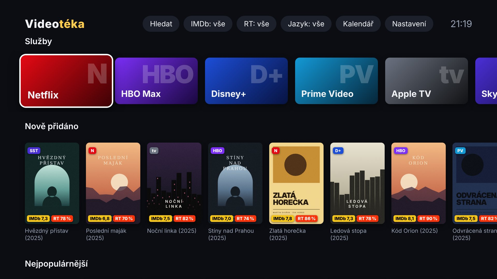
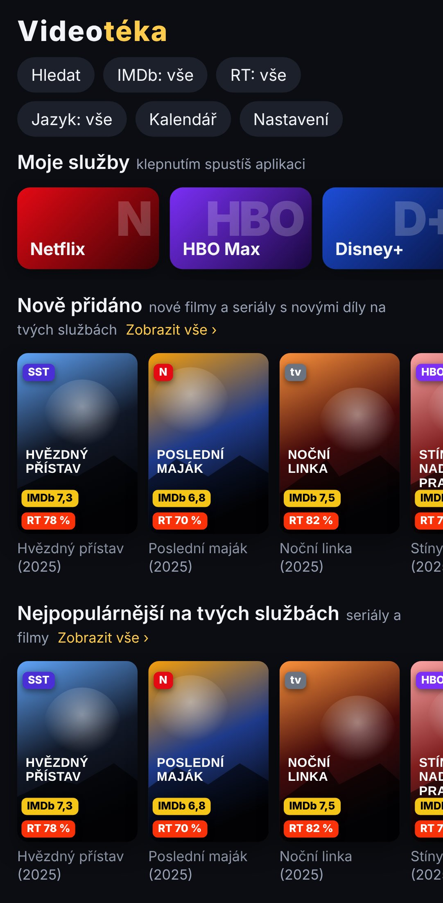

<p align="center">
  
</p>

<h1 align="center">Videotéka</h1>

<p align="center">
  Nabídka všech streamovacích služeb na jedné obrazovce.<br>
  Android · iPhone (webová aplikace) · televize Samsung
</p>

<p align="center">
  <a href="../../releases/latest/download/Videoteka.apk"><b>Stáhnout pro Android</b></a>
  &nbsp;·&nbsp;
  <a href="#iphone-a-webová-verze">iPhone a web</a>
  &nbsp;·&nbsp;
  <a href="#televize-samsung">Instalace do televize</a>
</p>

<p align="center">
  
</p>
<p align="center">
  
  
  
</p>

Videotéka spojuje katalogy služeb Netflix, HBO Max, Disney+, Prime Video, Apple TV
a SkyShowtime. Tituly třídí podle žánrů, zobrazuje u nich hodnocení IMDb a Rotten Tomatoes
a jedním výběrem je otevírá v aplikaci příslušné služby.

## Funkce

- Kategorie podle žánrů, obsahující pouze tituly z vybraných služeb, s řazením podle
  popularity, hodnocení nebo data vydání
- Řádky Nejlépe hodnocené, Skryté klenoty, Oscarové filmy a Klasika
- Doporučení podle seznamu Chci vidět a zhlédnutých titulů
- Detail titulu se žánry, délkou, zemí původu a možností zobrazit anglický popis
- Trailery přehrávané přímo v aplikaci (telefon a web)
- Hodnocení IMDb a Rotten Tomatoes s filtrem podle hodnocení
- Filtr podle typu (filmy, seriály), období vydání, české tvorby a českého dabingu
- Nově přidané a brzy odcházející tituly, kalendář nových dílů
- Seznam Chci vidět, skrývání zhlédnutých a nezajímavých titulů
- Přímé otevření titulu v aplikaci služby (Android)
- Spárování telefonu s televizí a posílání titulů do televize
- Automatické aktualizace

## Android

1. Stáhnout [Videoteka.apk](../../releases/latest/download/Videoteka.apk)
   a nainstalovat (je potřeba povolit instalaci z tohoto zdroje).
2. V aplikaci otevřít **Nastavení → Klíče** a vložit klíče podle tabulky níže.

## iPhone a webová verze

Videotéka běží také jako webová aplikace na adrese repozitáře na GitHub Pages
(`https://<uživatel>.github.io/<repozitář>/`).

1. Adresu otevřít v Safari.
2. Zvolit **Sdílet → Přidat na plochu**. Videotéka se pak spouští z plochy na celou obrazovku.
3. V **Nastavení → Klíče** vložit klíče podle tabulky níže.

Služby a tituly se otevírají odkazem, který v telefonu převezme aplikace dané služby.
Webová verze se aktualizuje sama při načtení. GitHub Pages se u repozitáře zapíná jednou
v *Settings → Pages → Deploy from a branch → main / (root)*.

## Klíče

Data pocházejí z veřejných filmových databází, které vyžadují bezplatný klíč. Každý uživatel
si klíče zřizuje sám; povinný je pouze klíč TMDB.

| Klíč | Účel | Registrace |
|---|---|---|
| TMDB | katalog, plakáty, vyhledávání (povinný) | [themoviedb.org](https://www.themoviedb.org/settings/api) |
| OMDb | hodnocení IMDb a Rotten Tomatoes | [omdbapi.com](https://www.omdbapi.com/apikey.aspx) |
| Watchmode | přímé otevření titulu ve službě | [watchmode.com](https://api.watchmode.com/requestApiKey/) |
| Movie of the Night | český dabing, nové a odcházející tituly | [movieofthenight.com](https://developers.movieofthenight.com/) |

Postup pro jednotlivé klíče je uveden přímo v aplikaci u každého klíče.

<details>
<summary>Limity bezplatných klíčů</summary>

- **OMDb:** 1 000 dotazů denně. Hodnocení se ukládají na 7 dní.
- **Watchmode:** 1 000 dotazů měsíčně. Dotaz se odesílá pouze při otevření titulu, odkaz se
  ukládá na 30 dní.
- **Movie of the Night:** 1 000 dotazů měsíčně. Aplikace se zastaví na 950 dotazech; spotřeba
  je uvedena v Nastavení → Aplikace.

</details>

## Televize Samsung

Instalace probíhá jednorázově přes vývojářský režim televize a Tizen Studio.

1. Nainstalovat [Tizen Studio](https://developer.tizen.org/development/tizen-studio/download)
   a v Package Manageru doplnit **TV Extensions** a **Samsung Certificate Extension**.
2. V televizi otevřít *Aplikace*, na ovladači zadat **1 2 3 4 5**, zapnout **Developer mode**,
   zadat IP adresu počítače a televizi restartovat.
3. V Tizen Studiu připojit televizi (*Tools → Device Manager*) a v *Certificate Manageru*
   vytvořit certifikát **Samsung → TV**.
4. V Device Manageru u televize zvolit **Permit to install applications**.
5. Vytvořit projekt *Tizen Project → TV → Web Application → Basic Project* s názvem
   `Videoteka`, nahradit jeho obsah soubory z tohoto repozitáře a spustit
   *Run As → Tizen Web Application*.

Klíče se do televize přenášejí z telefonu: v televizi *Nastavení → Telefon → Zapnout*,
v telefonu *Nastavení → Televize → Naskenovat QR kód*.

<details>
<summary>Starší televize (2016–2017) a instalace z příkazové řádky</summary>

Na starších modelech je ověřeno Tizen Studio 6.1. Soubory `js/jsqr.js` a
`js/jsqr.LICENSE.txt` televize nepotřebuje. Pokud instalace z Tizen Studia selže, lze
podepsaný balíček nainstalovat příkazy:

```
sdb.exe -s <IP-televize>:26101 install "C:\…\Videoteka.wgt"
sdb.exe -s <IP-televize>:26101 shell 0 vd_appinstall PrMtArNa01.Videoteka /home/owner/share/tmp/sdk_tools/Videoteka.wgt
```

Chyba `install failed[118]` znamená, že v Device Manageru chybí krok
*Permit to install applications*. Certifikát platí přibližně rok; další instalace musí
být podepsány stejným certifikátem.

</details>

<details>
<summary>Ovládání</summary>

| Tlačítko | Akce |
|---|---|
| Šipky, OK | pohyb, otevření |
| Zpět | předchozí obrazovka |
| Červené | skrýt titul |
| Zelené | označit jako zhlédnuté |
| Žluté | vrátit poslední skrytí |

Pokud se některá služba nespustí, lze její aplikaci vybrat v *Nastavení → Služby*.

</details>

## Vlastní kopie

Kdo chce mít Videotéku nezávislou na tomto repozitáři (vlastní aktualizace, vlastní úpravy),
vytvoří si kopii na GitHubu. Aplikace sestavená z kopie se aktualizuje pouze z ní.

1. Na GitHubu zvolit **Fork** (vpravo nahoře) a vytvořit kopii pod vlastním účtem.
2. V kopii otevřít záložku **Actions** a povolit workflowy
   (*I understand my workflows, go ahead and enable them*).
3. Volitelně nastavit podpisový klíč (viz níže). Bez něj se APK podepíše dočasným klíčem:
   aplikace funguje a obsah se aktualizuje, ale novější APK pak nejde nainstalovat přes
   starší bez odinstalace.
4. V *Actions → Mobilní aplikace (APK)* zvolit **Run workflow**. Po dokončení je APK
   v sekci **Releases** kopie a odkaz *Stáhnout pro Android* v README kopie vede na něj.
5. Pro televizi je potřeba v souboru `js/boot.js` přepsat `var REPO = '…'` na vlastní
   úložiště (`uzivatel/nazev`) a teprve potom aplikaci nainstalovat.

Aktualizace z původního repozitáře se do kopie nedostanou, dokud je vlastník kopie sám
nepřevezme (na GitHubu tlačítkem *Sync fork*).

<details>
<summary>Podpisový klíč pro APK</summary>

Klíč se vytvoří jednou (vyžaduje Javu, příkaz `keytool`):

```
keytool -genkeypair -v -keystore videoteka.jks -alias videoteka -keyalg RSA -keysize 2048 -validity 10000
```

V kopii v *Settings → Secrets and variables → Actions* přidat čtyři secrets:

| Název | Hodnota |
|---|---|
| `VIDEOTEKA_KEYSTORE_B64` | obsah souboru převedený do base64 (`base64 -w0 videoteka.jks`, ve Windows `[Convert]::ToBase64String([IO.File]::ReadAllBytes("videoteka.jks"))`) |
| `VIDEOTEKA_KEYSTORE_PASSWORD` | heslo k souboru |
| `VIDEOTEKA_KEY_ALIAS` | `videoteka` |
| `VIDEOTEKA_KEY_PASSWORD` | heslo ke klíči |

Soubor `videoteka.jks` a hesla je potřeba bezpečně uschovat a nikdy je nenahrávat do
repozitáře.

</details>

## Soukromí

Videotéka nemá účty ani vlastní server. Klíče, seznamy a nastavení zůstávají v zařízení.
Spárování telefonu s televizí využívá službu ntfy.sh; zprávy jsou šifrované kódem z QR kódu,
který se nikam neodesílá.

## Omezení

Streamovací služby nemají veřejné rozhraní. Videotéka proto nepřehrává video sama, nezná
historii sledování a údaje o dostupnosti mohou být o den či dva opožděné.

## Zdroje a licence

Videotéka používá TMDB API, ale není schválena ani certifikována společností TMDB. Data
o dostupnosti poskytuje JustWatch prostřednictvím TMDB, hodnocení OMDb. Videotéka není
spojena s žádnou z uvedených streamovacích služeb; jejich názvy jsou ochranné známky
příslušných vlastníků.

Použité knihovny: [qrcode-generator](https://github.com/kazuhikoarase/qrcode-generator) (MIT),
[jsQR](https://github.com/cozmo/jsQR) (Apache 2.0).

<details>
<summary>Pro vývojáře</summary>

#### Aktualizace

Aplikaci stačí nainstalovat jednou, další verze se stahují z tohoto repozitáře:

- **Kontrola:** při spuštění, nejvýše jednou za 6 hodin, a ručně v *Nastavení → Aplikace*.
- **Nasazení:** nová verze se stáhne, uloží a použije při příštím spuštění. Jednou se poté
  zobrazí přehled novinek.
- **Pojistka:** pokud nová verze nenaběhne, Videotéka se při dalším spuštění vrátí
  k nainstalované verzi. Ručně lze verzi vrátit v nastavení.
- **Klíče** v `js/config.js` se aktualizací nepřepisují.

Novou instalaci vyžaduje pouze změna oprávnění nebo zavaděče (`version.json` → `minShell`;
aplikace na to upozorní) a vypršení certifikátu televize.

**Vydání nové verze:** zvýšit číslo ve `version.json` i v `js/version.js` a odeslat do `main`.
GitHub Action *Kontrola vydání* ověří syntaxi, zvýšení verze a prázdné klíče v `js/config.js`.
Workflow *Mobilní aplikace (APK)* pak sestaví podepsané APK a zveřejní je jako vydání.

> Repozitář je veřejný. Klíče se vyplňují pouze v kopii nahrávané do televize a nesmí
> se commitovat.

#### Mobilní aplikace

Obal pro Android je ve složce `mobile/` (WebView). Obsah aplikace se aktualizuje stejně jako
v televizi; nové APK je potřeba pouze při změně obalu. Aby šlo novou verzi nainstalovat přes
starou bez ztráty dat, je potřeba podpisový klíč (secrets `VIDEOTEKA_*`, popsané
v `.github/workflows/apk.yml`). Sestavení z každého commitu je k dispozici také v *Actions →
Mobilní aplikace (APK) → Artifacts*.

#### Struktura

```
config.xml       manifest Tizen aplikace (oprávnění: internet, spouštění aplikací)
index.html       vstup
css/style.css    vzhled pro 1920×1080 a mobilní rozvržení
js/config.js     klíče, země, jazyk
js/services.js   seznam služeb, jejich barvy, TMDB ID a ID aplikací v TV
js/boot.js       zavaděč: vybere nainstalovanou nebo staženou verzi, stahuje aktualizace
js/version.js    verze přibalená v instalaci
version.json     nejnovější verze pro aktualizace
mobile/          obal mobilní aplikace (Android, WebView)
js/app.js        celá logika: navigace ovladačem, obrazovky, zdroje dat, spouštění aplikací
docs/            snímky obrazovky do README
```

Náhled bez televize: v adresáři spustit `python3 -m http.server`, otevřít
<http://localhost:8000> a ovládat šipkami, Enterem a Escapem.

</details>
